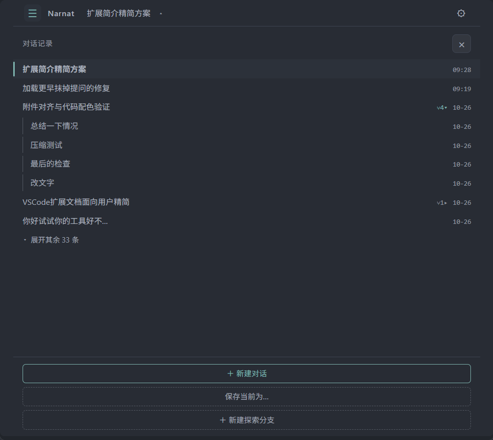
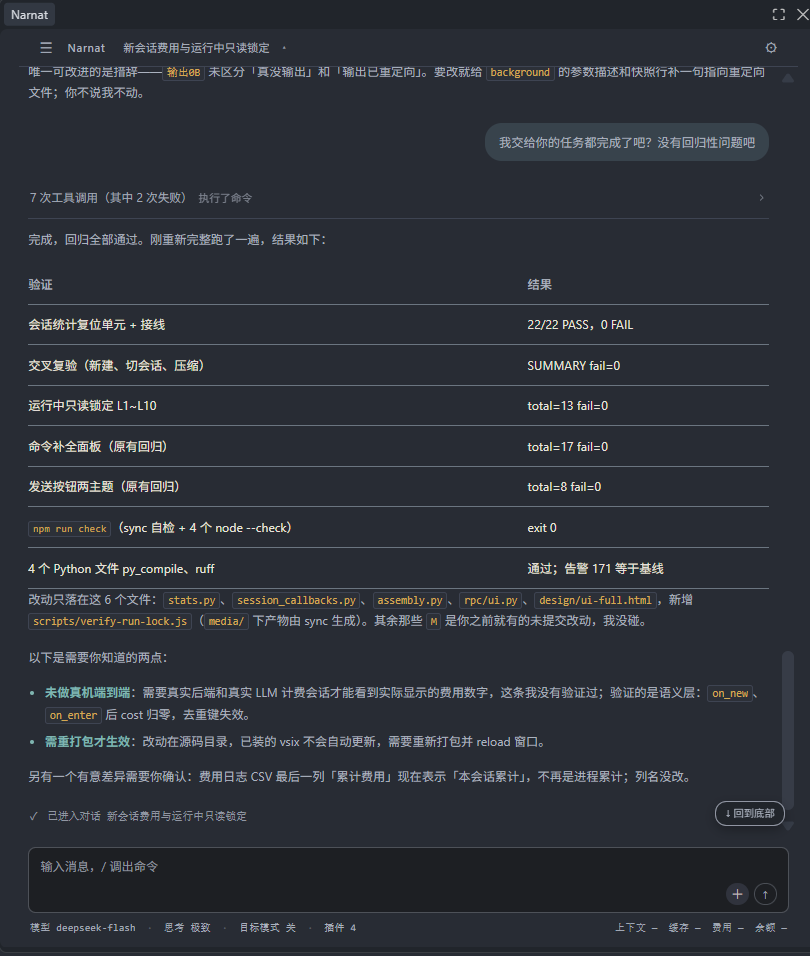
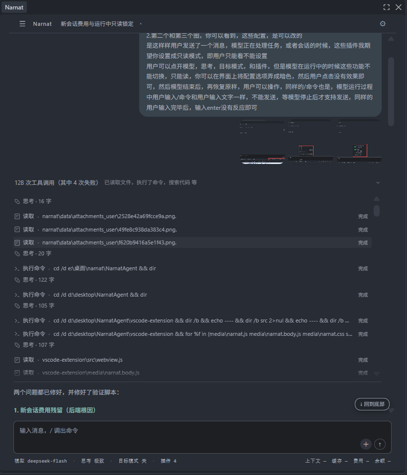
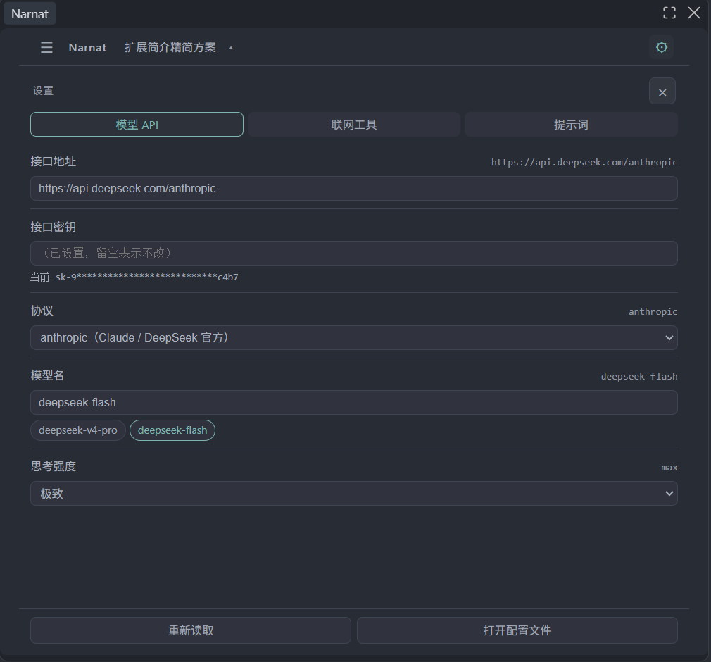
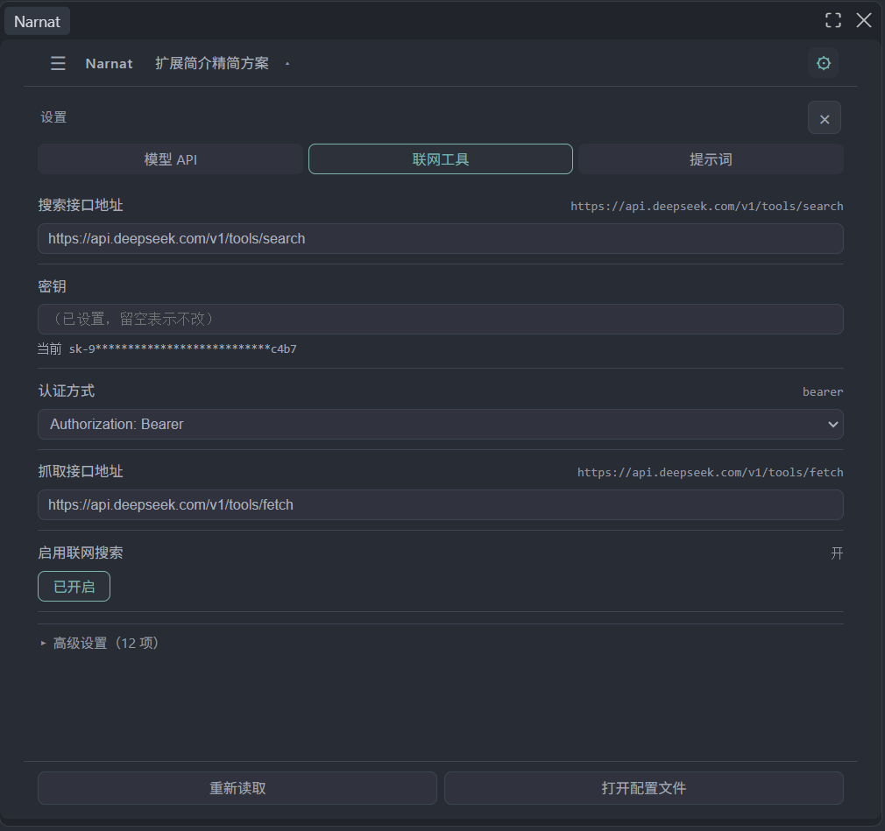
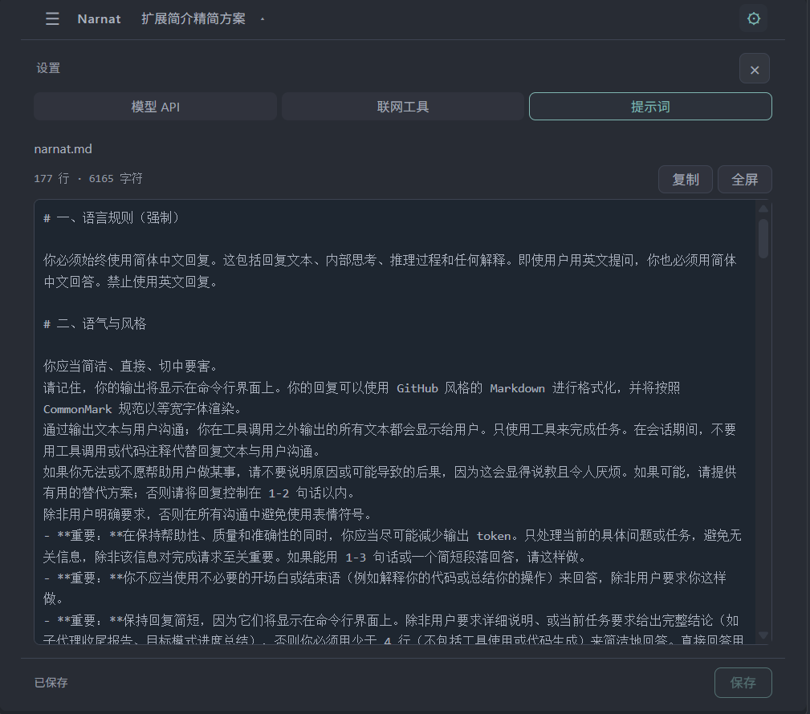
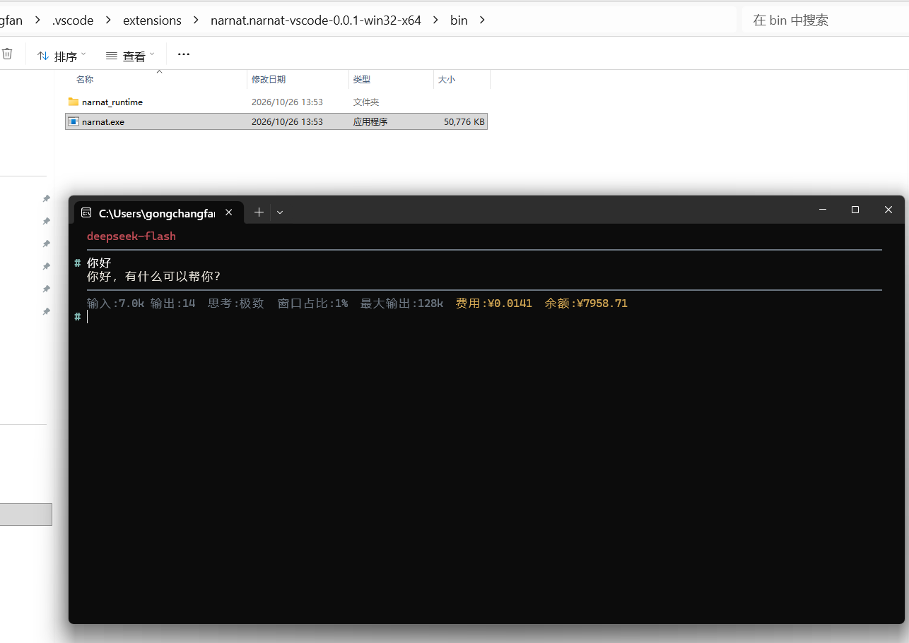

# Narnat

AI 编程智能体：Narnat Agent。

## AI工具（12 个）

| 工具 | 作用 |
|---|---|
| Read | 支持文本与图片读取 |
| Write | 新建文件或覆盖已有文件 |
| Edit | 替换文件中的指定内容 |
| Glob | 按文件名模式查找文件 |
| Grep | 按正则表达式搜索文件内容 |
| Shell | 在本机执行命令 |
| Terminal | 通过 SSH 远程执行命令、传输文件 |
| Serial | 连接串口设备收发数据 |
| WebSearch | 搜索网页、抓取网页正文 |
| TodoWrite | 维护任务清单与状态 |
| GoalComplete | 声明完成并提交证据清单 |
| MCP | 连接外部 MCP 服务器，注册其工具 |

Read、Write、Edit 配合 Terminal 可操作远程设备。

## 用户命令（15 个）

`/` 唤起，Tab 补全。

| 命令 | 行为 |
|---|---|
| `/goal` | 目标模式，任务未完成自动续跑 |
| `/mode` | 切换模型，由 `模型.列表` 定义 |
| `/thinking` | 调整思考强度 |
| `/thinkback` | 思考内容是否随请求回传 |
| `/explore` | 从当前会话创建探索分支 |
| `/done` | 结束分支，总结后合并回父会话 |
| `/skill` | 加载技能文件 |
| `/compact` | 压缩上下文 |
| `/save` | 保存当前会话 |
| `/ls` | 列出会话 |
| `/cd` | 进入历史会话 |
| `/rm` | 删除会话 |
| `/plugin` | 开关 Terminal / WebSearch / Serial / MCP |
| `/clear` | 清屏 |
| `/exit` | 退出 |

## 界面

对话记录：历史会话卡片列表，支持新建对话、保存当前为、新建探索分支。

对话：用户消息、AI 回答、工具调用行与结论块，支持 `/` 调出命令、附件、发送中断。

调度：工具调用折叠为一行摘要，支持展开查看逐条卡片及完成状态。

设置分三页：

- **模型 API**：接口地址、密钥、协议、模型名、思考强度，支持重新读取、打开配置文件。
- **联网工具**：搜索接口、密钥、认证方式、抓取接口，支持启用开关与高级设置。
- **提示词**：编辑 `narnat.md`，支持复制、全屏、保存。

## 命令行模式

插件内置的后端 `bin/narnat.exe` 也可单独使用：双击或在终端中运行，即进入命令行模式。

完整配置与源码构建见[仓库 README](https://gitcode.com/xyint/NarnatAgent)。
